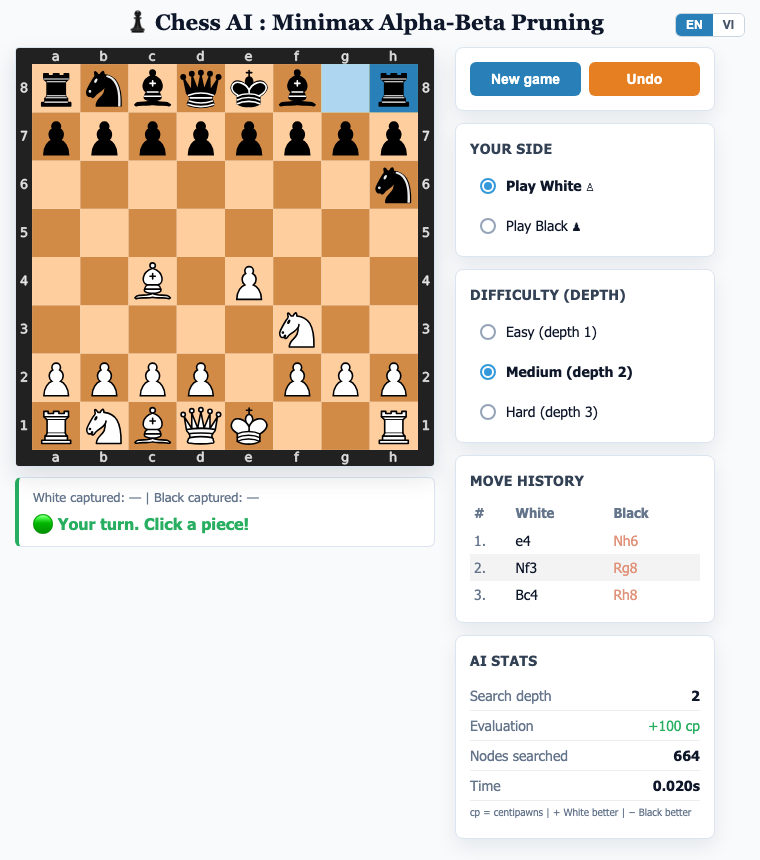

# ♟️ Chess AI — Minimax with Alpha-Beta Pruning

Play chess in your browser against an AI that thinks ahead using the classic **Minimax** search, sped up with **Alpha-Beta pruning**.



## Features

- **Click-to-move** board with legal-move highlighting
- **Play as White or Black**: the AI moves first if you pick Black
- **3 difficulty levels**: Easy / Medium / Hard (search depth 1–3)
- **Undo** and **New game**
- **Move history** in standard notation
- **Live AI stats**: search depth, position score, nodes searched, and thinking time
- **English / Vietnamese** interface (EN | VI toggle)

## Quick Start

Requires **Python 3.10+**.

```bash
git clone https://github.com/LionelHuanSi/Chess_AI_Minimax.git
cd Chess_AI_Minimax/chess_ai

python3 -m venv .venv
source .venv/bin/activate        # Windows: .venv\Scripts\activate

pip install -r requirements.txt
python main.py
```

The game opens automatically at **http://127.0.0.1:5678**.

## How the AI Works

### 1. Minimax: assume the opponent plays its best move

The AI builds a tree of possible moves a few turns ahead:

```text
                 Current position
           ┌──────────┼──────────┐
        Move A      Move B      Move C        ← AI picks the MAX score
        ┌──┴──┐     ┌──┴──┐     ┌──┴──┐
       +1    -3    +2    +5    -1    0       ← Opponent picks the MIN score
        └─ -3       └─ +2       └─ -1
                       ▲
                Best move: B (+2)
```

- On **its own turn**, the AI picks the move with the **highest** score.
- On **the opponent's turn**, it assumes the opponent picks the **lowest** score.
- When it reaches the search depth limit (or the game ends), it scores the position.

### 2. Position evaluation: count material

Each position is scored from White's point of view, in centipawns (1 pawn = 100):

| Pawn | Knight | Bishop | Rook | Queen |
|:---:|:---:|:---:|:---:|:---:|
| 100 | 320 | 330 | 500 | 900 |

A positive score means White is ahead and a negative one means Black is ahead. Checkmate scores ±99,999 and a draw scores 0.

### 3. Alpha-Beta pruning: skip branches that can't matter

While searching, the AI tracks two bounds:
- **α (alpha)**: the best score the AI is already guaranteed
- **β (beta)**: the best score the opponent is already guaranteed

If a branch can't do better than an option already found (**α ≥ β**), the AI stops searching it. Alpha-Beta always picks **the same move** as plain Minimax, but it searches far fewer positions:

| Depth 3 (after 1.e4) | Nodes searched | Time |
|---|---:|---:|
| Minimax | 13,780 | 0.51 s |
| Minimax + Alpha-Beta | **1,924** | **0.07 s** |

To compare the two, set `USE_ALPHA_BETA` in [`ai/minimax.py`](chess_ai/ai/minimax.py).

## Project Structure

```text
chess_ai/
├── main.py              # Entry point
├── ai/minimax.py        # Minimax + Alpha-Beta search
├── game/game_logic.py   # Position evaluation
└── ui/ui.py             # Flask web UI
```

## Roadmap

- Piece-square tables (reward good piece placement)
- Move ordering and quiescence search
- Transposition table

## Tech Stack

Python · [python-chess](https://python-chess.readthedocs.io/) · Flask
